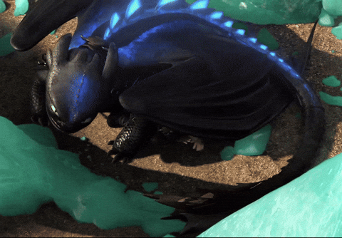

 

<!-- Put a Toothless gif in the assets folder and name it toothless.gif -->

---

## 🌑 About Me

> *"Hiccup didn't tame Toothless by force. He earned trust, one careful step at a time. I try to treat data the same way."*

- 🎓 BS student at **FAST NUCES**, specialising in **Data Science**
- 📊 I turn messy datasets into clear stories: cleaning, exploring, modelling, and explaining
- ⚙️ I also like going low-level: **C, C++ and Assembly** keep me honest about what the machine is really doing
- 🌐 Full-stack curious: I build web apps with **React, Node.js and Supabase**
- 🐉 Open to collaborations, hackathons, and anything that involves making smart things fly

---

## 🔥 Tech Stack

### Languages

  
  
  
  
  

### Data Science (my dragon-training toolkit)

  
  
  
  
  
  

### Web & Backend

  
  
  
  
  
  
  

### Tools & Platforms

  
  
  
  
  
  
  
  
  
  
  
  

---

## 🐲 Featured Projects

<table>
  <tr>
    <td width="50%">
      <h3>🌀 Recursion Hell</h3>
      
A competitive <strong>puzzle platform</strong> set in a <strong>Stranger Things-inspired</strong> world. Players solve <strong>graph-based puzzles</strong> while a <strong>real-time leaderboard</strong> (Supabase Realtime) updates live. Floating ember particles and a glassmorphism UI give it that Upside Down atmosphere.

      
<code>Node.js</code> <code>TypeScript</code> <code>React</code> <code>Supabase</code> <code>SVG</code>

    </td>
    <td width="50%">
      <h3>📚 <a href="https://github.com/tridibbanik17/CUTC-Transform-Hackathon-2026">CourseChat</a></h3>
      
A Chrome extension that turns your course materials into an <strong>AI tutor</strong>. Upload lectures and exams, ask questions, and get answers with <strong>cited sources</strong> (file name and page). Uses RAG so only the most relevant chunks go to Gemini, with a free API key. Built with a team at <strong>CUTC Transform Hackathon 2026</strong>, where I worked on the <strong>data pipeline</strong>: platform adapters, document processor and content extraction.

      
<code>TypeScript</code> <code>React</code> <code>Chrome MV3</code> <code>Gemini API</code> <code>RAG</code>

    </td>
  </tr>
</table>

---

## 🤝 Open to Collaborate

*"Hiccup never flew alone. Neither should my projects."* 🐉

Got an idea that needs a rider? I'd love to build with you on:

| 🔥 Quest | What it looks like |
|---|---|
| **Data science and ML** | Kaggle competitions, EDA, model building, turning messy data into clear insights |
| **Hackathons** | Fast teams, big ideas, shipping before the deadline |
| **Full-stack builds** | React, Node.js and Supabase apps, from first sketch in Figma to deployed on Vercel |
| **Low-level projects** | C, C++ and Assembly, where you get to see what the machine is really doing |

**Best way to reach me:** send a message on [LinkedIn](https://www.linkedin.com/in/hunabuilds/) or [Kaggle](https://www.kaggle.com/hunzashahzadi). Tell me what you're building and let's see if our dragons can fly together.

---

## 🌐 Let's Connect

---

*"Dragons aren't what you thought they were. Neither is data."* 🌑

